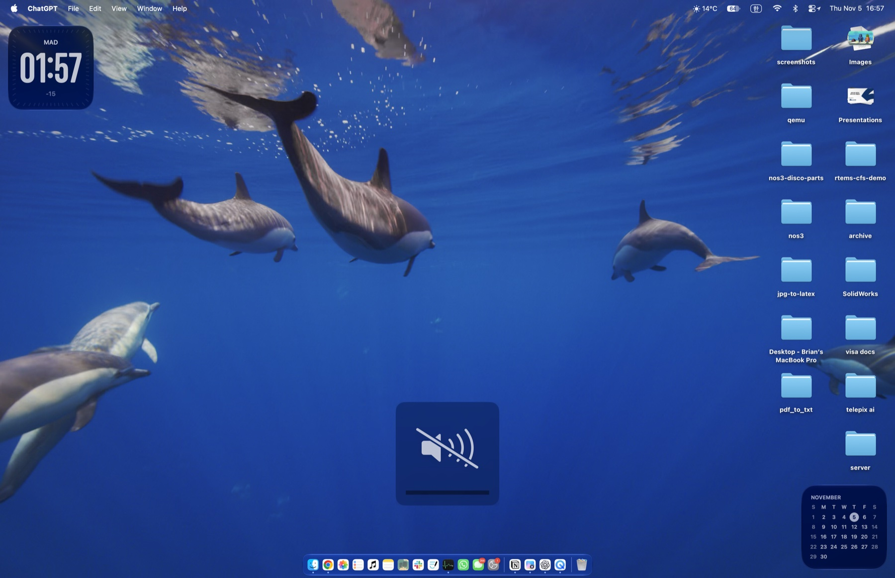

# Pre-Tahoe UI

<p align="center"></p>

A small macOS utility that restores a centered volume and brightness indicator. It replaces the macOS Tahoe indicators when Accessibility access is granted.

## Screenshots

| Volume | Brightness | Muted |
| --- | --- | --- |
|  |  |  |

## Features

- Classic volume and brightness indicators: three volume waves at every level with a slash at zero, and four evenly spaced sun-ray lengths for brightness, above a segmented bar.
- Smooth brightness changes using macOS DisplayServices.
- A stationary indicator while switching desktops.
- Separate display duration controls for volume and brightness, plus opacity controls for the small white bars and their black background.
- Background operation without a menu bar icon. Open the app again to show settings or quit.

## Install

Requires macOS Tahoe or later. If needed, install Xcode Command Line Tools with `xcode-select --install`. Then run:

```sh
git clone https://github.com/SeungjH/pre-tahoe-ui.git && cd pre-tahoe-ui && ./install.sh
```
The script installs and opens **Pre-Tahoe UI** in Applications. In **System Settings → Privacy & Security → Device Control and Data Access**, add and enable `/Applications/Pre-Tahoe UI.app`. Open the app again for settings or to quit.

## Uninstall

From the cloned repository, run:

```sh
./uninstall.sh
```

The script stops Pre-Tahoe UI, unregisters its login item, and removes `/Applications/Pre-Tahoe UI.app`. It checks the app's bundle identifier before removing anything. If your installed copy is older than this script, run `./install.sh` once to update it, then rerun `./uninstall.sh`. Your settings remain available if you reinstall. To remove the old permission entry as well, go to **System Settings → Privacy & Security → Device Control and Data Access**.

The included `Resources/Assets.car` contains MIT-licensed upstream sound and icon assets, while `Resources/volumeHUD.icns` is this fork's app icon. These let the command-line build work without Xcode's asset catalog compiler. The Xcode project is also included.

## If both indicators appear

An app update can invalidate macOS's permission for a locally signed build. In **System Settings → Privacy & Security → Device Control and Data Access**, remove the old **Pre-Tahoe UI** entry, add `/Applications/Pre-Tahoe UI.app` again, then quit and reopen the app.

## Compatibility

The stationary overlay and smooth brightness adjustment use private macOS APIs. A future macOS update may require changes. Brightness control is intended for built-in displays. The app uses the bundle identifier `local.classicvolumehud` to retain settings and Accessibility access from earlier local builds.

## Credits and license

Pre-Tahoe UI is maintained by Brian Han and based on [volumeHUD by Danny Stewart](https://github.com/dannystewart/volumeHUD) version 3.3.4. The original and this modified source are distributed under the [MIT License](LICENSE). See [CUSTOM_FORK.md](CUSTOM_FORK.md) for the changes in this version.
